# 漫画+小说 桌面端 · UI 全面分析与新设计提案

> 版本基线:`V0.19.6`(commit `fb47ce8`)
> 分析对象:`static/index.html`(7408 行单文件 UI)、`gui_server.py`(4837 行)、`novel/*`
> 结论性质:全部数据来自实机截图与实机接口实测,未使用推测值

---

## 0. 摘要

**现状**:功能完成度很高(多源聚合搜索、话级续传与补齐、验证中心、手机端),但界面层背着 7400 行单文件 UI 的历史债 —— 586 处内联样式、280 个硬编码色值、471 个 emoji 充当图标、33 个 SVG 图标与 emoji 混用、296 处内联 `onclick`。视觉上表现为"每个页面像不同人做的",且**实测有 4 组关键文字对比度不达标**(最低 2.20:1,门户绿/橙卡上的白字)。

**新设计**:采用"暖纸墨色"令牌体系,单一强调色(墨绿 `#2C6E63`),小说/漫画两个模式只用低饱和强调色区分;**26/26 组对比度全部达标**;深浅色完整;图标统一为同一套线性 SVG;设置页改为分组 + 吸底保存;书架的操作层从"4 个拉满宽度的按钮"改为"封面悬停操作 + 单项主操作 + 更多菜单"。

**代码检查**:发现 5 个可复现问题,其中 2 个有实机数据支撑:

| 编号 | 问题 | 严重度 | 证据类型 |
|---|---|---|---|
| BUG-1 | 一个慢书源把聚合搜索从 3 秒拖到 **124 秒**,期间 UI 全程"正在搜索" | 高 | 实机接口计时 |
| BUG-2 | 11 个"已启用"书源里 **7 个根本没有搜索规则**,却计入进度分母 | 中 | 实机书源统计 |
| BUG-3 | 连续失败的书源被**静默跳过**,界面上没有任何提示 | 中 | 代码路径 |
| BUG-4 | OPDS 验证 Cookie **写入目录与读取目录不一致**,特定部署下验证不生效 | 中 | 代码路径 |
| BUG-5 | 通知气泡硬编码浅色色值,**深色模式下不跟随主题** | 低 | 代码路径 |

---

## 1. 分析方法与证据链

| 手段 | 说明 | 产出 |
|---|---|---|
| 界面实拍 | Playwright + 系统 Edge(headless,1440×900 / 1024×720),针对本地服务逐屏截图;先关掉首启说明弹窗再拍 | `shots/cur-*.png`(18 张) |
| 新设计实拍 | 同一套截图管线,对象换成原型页面 | `shots/new-*.png`(11 张) |
| 对比图 | PIL 拼接"现状 vs 新设计"四组关键页面 | `shots/compare-overview.png` |
| 代码量化 | 正则统计结构性问题数量 | 本文 §2.1 |
| 对比度实测 | 按 WCAG 2.1 相对亮度公式逐对计算 | `contrast_check.py`(现状与新方案各一份) |
| 接口实测 | 直接轮询 `/api/search_async` + `/api/search_progress`,记录每个书源完成时刻 | 本文 BUG-1 / BUG-2 |

复现命令(均在项目根目录执行;工具都在 `design/tools/`):

```bash
# 1) 启动本地服务(用隔离的数据目录,不动用户真实数据)
#    PowerShell:
#    $env:NOVEL_DATA_DIR="design\tools\_work\data"; $env:TEMP="design\tools\_work\tmp"
#    bundle314\Scripts\python.exe gui_server.py --port 8899 --host 127.0.0.1

# 2) 现状截图(需要上面的服务在 8899 端口)
bundle314/Scripts/python.exe -X utf8 design/tools/shoot.py
# 3) 新设计截图(纯静态页面,不需要服务)
bundle314/Scripts/python.exe -X utf8 design/tools/shoot_proto.py
# 4) 对比度校验 / 结构指标 / 拼对比图
bundle314/Scripts/python.exe -X utf8 design/contrast_check.py
bundle314/Scripts/python.exe -X utf8 design/tools/metrics.py
bundle314/Scripts/python.exe -X utf8 design/make_compare.py

# 5) BUG-1 / BUG-2 的证据复现(需要服务在跑)
bundle314/Scripts/python.exe -X utf8 design/tools/shoot_search_state.py  # 搜索中/搜索完 两个真实状态截图
bundle314/Scripts/python.exe -X utf8 design/tools/probe_search_slow.py   # 每个书源的完成时刻
bundle314/Scripts/python.exe -X utf8 design/tools/probe_enabled.py       # 启用源中有几个可真搜
```

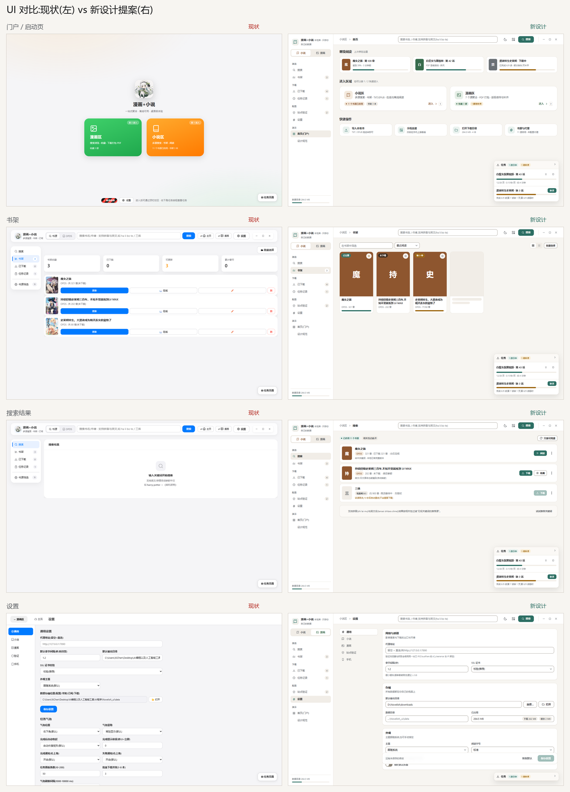

---

## 2. 现状诊断

### 2.1 结构性指标(`static/index.html` 实测)

| 指标 | 实测值 | 说明 |
|---|---|---|
| 文件行数 | **7408** | 单文件承载 HTML + CSS + JS |
| 内联 `style="..."` | **586** | 样式无单一来源,改一处颜色要翻几百行 |
| 硬编码 hex 色值 | **280** | 绕过了已有的 `--primary` 等令牌,深色模式必然漏改 |
| 硬编码 `font-size:Npx` | **284** | 与 `--fs-caption` 等字号令牌并存,字阶实际失控 |
| `innerHTML =` | **153** | 拼字符串渲染,转义靠人工 |
| 内联 `onclick=` | **296** | 无事件委托、无 CSP 余地 |
| 结构性 emoji/符号 | **471** | `→`64、`✅`42、`☆`23、`✕`22、`📖`18、`⚠`17、`⏳`12、`⏹`7… |
| SVG 图标(sprite) | **33** | 已有图标库,但只用了一半场景,另一半用 emoji |
| `aria-*` 属性 | **46** | 7400 行只有 46 个,无障碍基本空白 |
| `:focus-visible` | **9** | 键盘焦点几乎不可见 |
| `!important` | **45** | 覆盖打架的体温计 |
| `@media` 断点 | **4** | 响应式只有零星几处 |

### 2.2 可访问性实测(WCAG 2.1)

| 组合 | 实测对比度 | 要求 | 结论 |
|---|---|---|---|
| 白字 / 门户绿卡 `#34C759` | **2.22:1** | 4.5:1 | ❌ 不达标 |
| 白字 / 门户橙卡 `#FF9500` | **2.20:1** | 4.5:1 | ❌ 不达标 |
| 白字 / 成功色 `#34C759` | **2.22:1** | 4.5:1 | ❌ 不达标 |
| 白字 / 主色 `#007AFF` | **4.02:1** | 4.5:1 | ⚠️ 仅大字号可用 |
| 白字 / 危险色 `#FF3B30` | **3.55:1** | 4.5:1 | ⚠️ 仅大字号可用 |
| 边框 `#d2d2d7` / 白底 | **1.51:1** | 3:1(非文本) | ❌ 不达标 |
| 正文 `#1d1d1f` / 白底 | 16.83:1 | 4.5:1 | ✅ AAA |
| 次要文字 `#6e6e73` / 白底 | 5.07:1 | 4.5:1 | ✅ AA |
| 次要文字 `#6e6e73` / 背景 `#f5f5f7` | 4.66:1 | 4.5:1 | ✅ 勉强 AA |

关键点:门户页是用户看到的**第一个**界面,而它最醒目的两个大按钮恰好是全应用对比度最差的元素(2.2:1)。另外文字色在"白底/灰底"之间切换时,同一个 `#6e6e73` 从 5.07 掉到 4.66,已经贴着及格线 —— 任何再加一点灰度的改动都会击穿它。

### 2.3 信息架构与导航

现状是"三层两种模型"并存:

1. **门户页(启动页)** —— 两个彩色大卡(漫画家 / 小说家)+ 首次使用说明气泡。
2. **模式切换** —— 进入某个模式后,顶栏出现"小说 / OPDS / 漫画"三态切换,侧栏整体换一套导航。
3. **设置页** —— 点"设置"后**全屏接管**,使用另一套左侧 5 分类导航(通用/小说/漫画/验证/手机),与主壳的侧栏不是同一套。

问题:

- 用户在同一应用里要理解**三套导航模型**(门户卡、模式侧栏、设置接管页),认知负担高。
- 门户页每次启动都弹出使用说明(`static/index.html:7355 showDevTip('main')`),且弹窗自带"我知道了"按钮,遮挡了它本想介绍的内容 —— 首屏第一印象是"要先关掉一个弹窗"。
- 书源筛选入口只在小说模式侧栏出现,OPDS 与漫画模式没有对应入口,功能对等性不一致。
- 门户页的"漫画区:已启用 7 个源 / 小说区:已启用 11 个书源"这类数字**与真实能力不符**(见 BUG-2)。

### 2.4 布局与视觉密度(附实拍)


- 两个 300px 宽的彩色卡居中悬浮,下方是大片空白;卡片上的白字对比度 2.2:1。
- 底部"最近任务"只有一个条目,却占据整个底栏宽度。

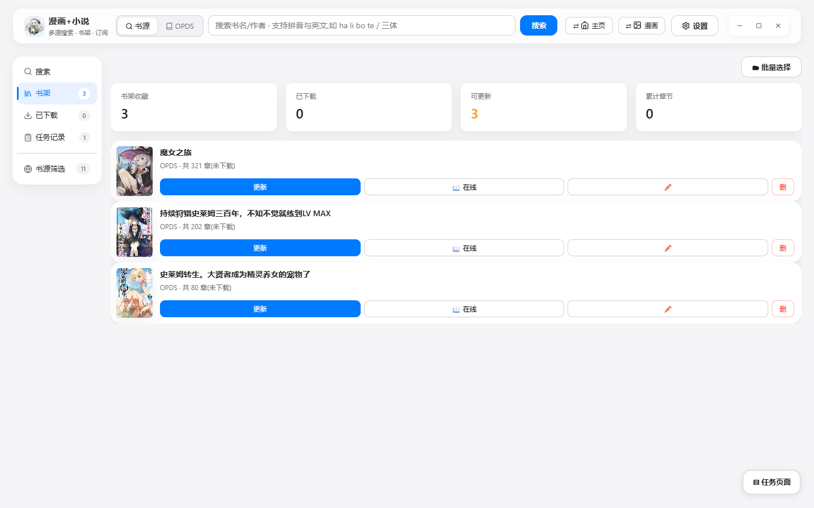

- 顶部 4 个统计卡:`书架 3 / 已下载 0 / 更新 0 / 已下载章节 0`,其中 3 个是 0 —— 零值信息占用了最显眼的黄金位置。
- 每条书架行右侧有 4 个按钮(更新 / 在线 / ✏️ / 删),CSS 里 `.book-card .bc-ops .btn-sm { flex:1 }`(`static/index.html:693-695`)把它们**平均拉伸到整行宽度**,于是蓝色的"更新"变成一条约 350px 宽的色带,视觉上像是进度条而不是按钮;点错区域会触发错误的操作。
- `✏️` 那个铅笔按钮既没有文字也没有 `aria-label`(`static/index.html:5707`),纯粹的图标按钮,**没有无障碍名称**。
- `删` 是单字按钮,危险操作与普通操作尺寸完全一致,没有视觉区分。

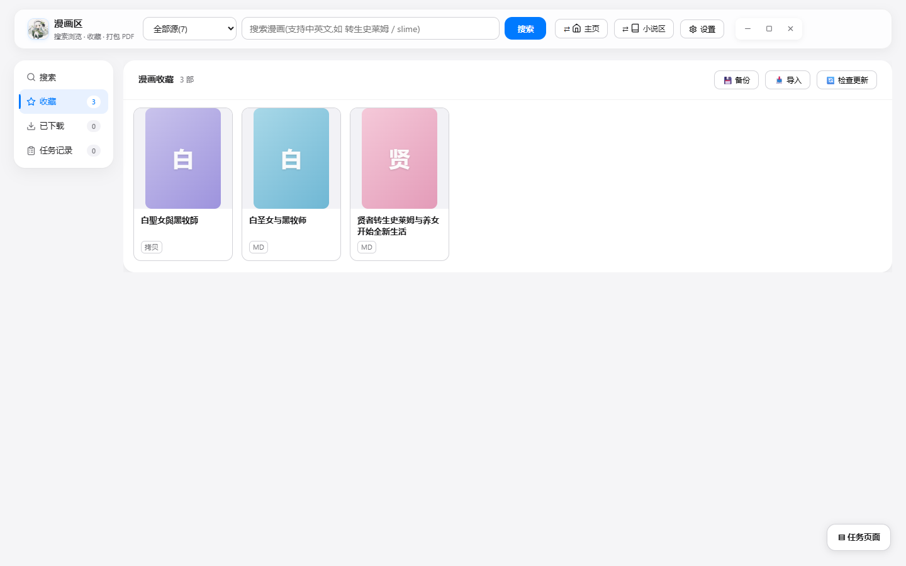

- 空状态卡片固定高度,在 900px 高的窗口里浪费约一半视口。
- 长书名不换行也不省略号,直接撑开行高。

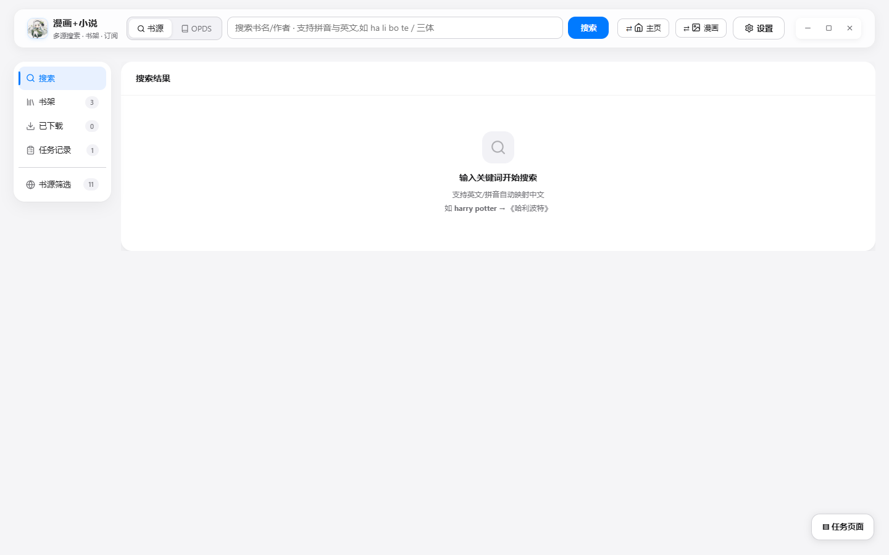
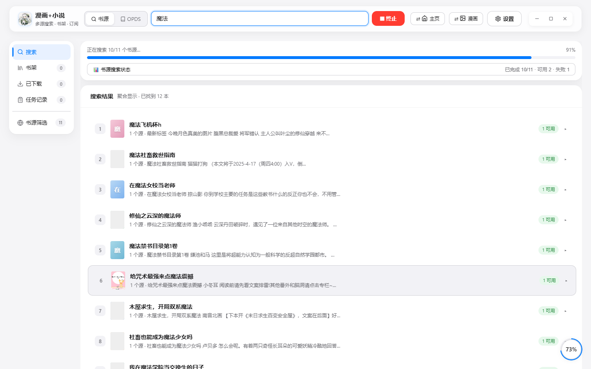
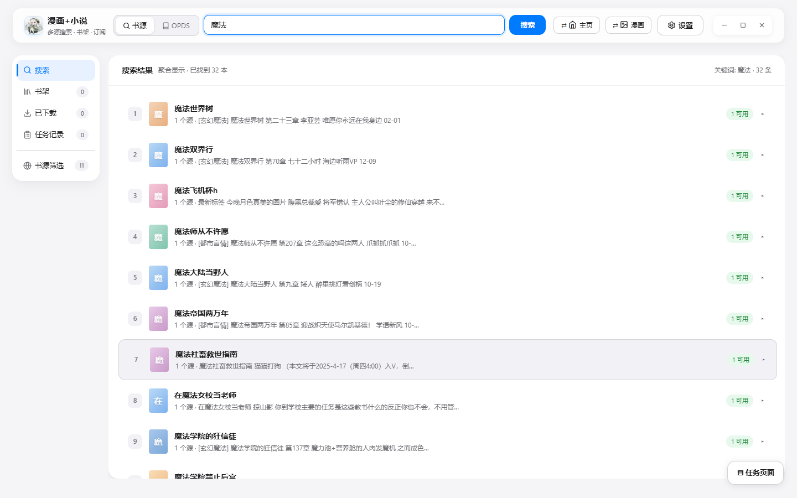

- 搜索有结果时的信息层级其实不错(序号 + 封面 + 标题 + 元信息),但每行右侧的「1 可用」绿色胶囊重复 22 次,是纯噪音;右侧还有一个圆形的滚动百分比气泡(91%)压住内容。
- 搜索进行中有**两条进度语义**:顶端细进度条 + "正在搜索 11/11 个书源… 100%",下面又有一条"书源搜索状态 · 已完成 11/11 · 可用 2 · 失败 2"。两者数字口径还不一致。
- 搜索结束后"终止"按钮与"正在搜索"文案可能长时间不消失(见 BUG-1)。

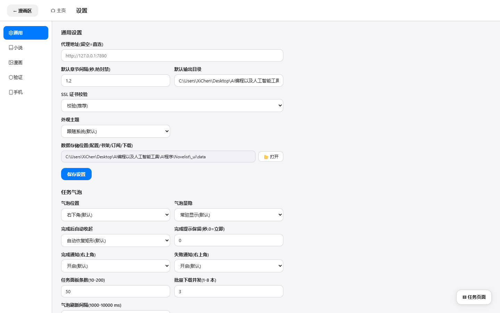

- 2560 宽屏下表单仍挤在左侧,右侧大面积留白;每个分区下方都有重复的"保存设置"按钮(共 5 处),没有脏值提示,也没有吸底主操作。
- 路径类文本(如数据目录)被裁切,没有省略号也没有"复制/打开"入口。

### 2.5 状态与主题完备性

- **深色模式**:存在 `prefers-color-scheme` 块与 `[data-theme="dark"]`(46 处),但覆盖是逐条 ad-hoc 加上的(45 处 `!important` 是征兆)。因为 280 处硬编码色值不参与主题切换,深色模式下必然存在漏改点;已确认一处:`notify()` 内联浅色(见 BUG-5)。
- **加载态**:有骨架/进度条机制,但搜索结果、已下载列表的加载态不统一。
- **空态**:存在 `emptyState()` 统一函数,但漫画书架的空态卡片高度固定,浪费视口。
- **错误态**:错误提示走 `toast`/`notify`,而 `notify` 硬编码颜色。
- **部分完成态**:下载侧已实现"部分完成"状态(`static/index.html:5281` 注入 `⚠ 部分完成(有缺失话)`),这是本项目的亮点,但入口埋在任务列表里,门户/书架没有汇总视图。

### 2.6 视觉与交互问题清单

| # | 问题 | 位置 | 严重度 |
|---|---|---|---|
| V1 | 门户两个主卡白字对比度 2.20–2.22:1 | 门户页样式 | 高 |
| V2 | 书架行 4 个按钮被 `flex:1` 拉满,主次不分、易误点 | `static/index.html:693-695` | 高 |
| V3 | `✏️` 图标按钮无文字、无 `aria-label` | `static/index.html:5707` | 高 |
| V4 | 每次启动都弹使用说明,遮挡首屏 | `static/index.html:7355` | 中 |
| V5 | 4 个统计卡里 3 个是 0,占用黄金位置 | 书架页 | 中 |
| V6 | 空态卡片固定高度,浪费约半个视口 | 漫画/小说书架 | 中 |
| V7 | 设置页全屏接管,与主壳导航模型不一致 | 设置页 | 中 |
| V8 | 同一动作有 5 个"保存设置"按钮,无脏值提示 | 设置页 | 中 |
| V9 | 搜索进度有两套口径(11/11 与 可用2/失败2) | 搜索页 | 中 |
| V10 | 每行重复「1 可用」胶囊 22 次 | 搜索结果行 | 低 |
| V11 | 滚动百分比气泡压住内容 | 搜索页右下 | 低 |
| V12 | 长路径/长书名裁切无省略号 | 设置、书架 | 低 |
| V13 | 471 处 emoji 作结构性图标,与 33 个 SVG 混用 | 全局 | 中 |
| V14 | 280 硬编码色 + 586 内联样式 + 284 硬编码字号 | 全局 | 中(技术债) |

---

## 3. 新设计:「纸墨 · Paper & Ink」

设计风格由设计库检索推荐为 *book-brown / page-amber 的扁平暖色调*,结合本项目是**离线桌面阅读工具**这一前提做了三点收敛:不引入网络字体、不引入动画库、不改变信息密度以换取"高级感"。

### 3.1 设计原则

1. **内容优先**:封面、书名、进度是主角;装饰性容器(彩色大卡、渐变、阴影)一律降级。
2. **单一强调色**:全局只用一个主色(墨绿),小说/漫画只作为**低饱和模式强调**出现在标签与图标上,不参与大色块。
3. **令牌唯一来源**:颜色、间距、圆角、字号、阴影、动效全部走 CSS 变量;**新代码禁止出现字面量色值**。
4. **状态即一等公民**:空/加载/错误/部分完成/禁用/深色 六态在组件层面统一。
5. **可测量的可访问性**:每对前景/背景都必须有实测对比度记录。

### 3.2 设计令牌

```css
:root{
  /* 表面:暖纸色系 */
  --paper:#F7F5F1; --surface:#FFFFFF; --surface2:#FBF9F6; --surface3:#F1EDE7;
  /* 文本 */
  --ink:#17181A; --ink2:#55595E; --ink3:#6B7075;
  /* 描边:line 仅装饰分隔;控件边框用 line-strong 以满足 1.4.11 */
  --line:#E7E2DA; --line-strong:#8C8579;
  /* 品牌 */
  --brand:#2C6E63; --brand-hover:#235A51; --brand-soft:#EAF2EF; --on-brand:#FFFFFF;
  /* 模式强调(低饱和) */
  --novel:#8E562F; --novel-soft:#F4EADE;
  --comic:#376C4C; --comic-soft:#E6EFE7;
  /* 语义 */
  --success:#2F7A4F; --warn:#9A6208; --warn-soft:#FAF0DC;
  --danger:#B3261E; --danger-soft:#FBEAE8;
  /* 间距(4/8 节奏)· 圆角 · 字号 */
  --s1:4px; --s2:8px; --s3:12px; --s4:16px; --s5:24px; --s6:32px; --s7:48px;
  --r1:8px; --r2:10px; --r3:14px; --r4:18px; --r-pill:999px;
  --f1:11px; --f2:12px; --f3:13px; --f4:14px; --f5:16px; --f6:20px; --f7:24px; --f8:30px;
  --sh1:0 1px 2px rgba(23,24,26,.05), 0 1px 1px rgba(23,24,26,.03);
  --sh2:0 10px 30px rgba(23,24,26,.12);
  --dur:160ms; --ease:cubic-bezier(.2,.8,.2,1);
}
[data-theme="dark"]{
  --paper:#17181A; --surface:#202225; --surface2:#26292C; --surface3:#2C3034;
  --ink:#F2F0EC; --ink2:#B9B6B0; --ink3:#96938D;
  --line:#33373B; --line-strong:#7A8078;
  --brand:#5FB39F; --brand-hover:#7CC7B4; --brand-soft:rgba(95,179,159,.16);
  --on-brand:#0F1113;      /* 深色下主色是浅青绿,必须用深字 */
  --novel:#D2A276; --novel-soft:rgba(210,162,118,.15);
  --comic:#89BB9C; --comic-soft:rgba(137,187,156,.15);
  --success:#7FC79A; --warn:#E0B062; --warn-soft:rgba(224,176,98,.15);
  --danger:#F08A80; --danger-soft:rgba(240,138,128,.15);
}
```

**对比度实测:26/26 全部达标**(校验脚本 `design/contrast_check.py`,节选):

| 组合 | 新方案 | 旧方案 |
|---|---|---|
| 正文 / 卡片 | 17.77:1 | 16.83:1 |
| 次要文字 / 卡片 | 7.05:1 | 5.07:1 |
| 三级文字 / 卡片 | 5.00:1 | – |
| 白字 / 主按钮 | 5.97:1 | 4.02:1 |
| 小说强调 / 小说卡底 | 5.02:1 | – |
| 漫画强调 / 漫画卡底 | 5.24:1 | – |
| 成功文字 / 卡片 | 5.23:1 | 2.22:1 |
| 警告文字 / 警告卡底 | 4.50:1 | – |
| 危险文字 / 危险卡底 | 5.61:1 | 3.55:1 |
| **控件边框 / 卡片** | **3.65:1** | **1.51:1** |

注意 `--on-brand` 这个令牌:深色模式下主色是浅青绿,**白字会掉到 2:1 以下**。原型第一版就踩了这个坑(主按钮写死 `color:#fff`),这正说明"令牌唯一来源"不是洁癖而是防错机制。

### 3.3 组件规范

| 组件 | 规范 |
|---|---|
| 按钮 | 高度 34(小号 28);主操作 1 个/视图;危险操作必须带语义底 `--danger-soft`,不与其他按钮同尺寸 |
| 图标按钮 | 仅图标时必须给 `aria-label`;悬停有底色;36–44px 命中区 |
| 标签/胶囊 | 22px 高,11px 字,`--xs-soft` 底 + `--x` 文字,不用于长文本 |
| 封面操作层 | 默认隐藏,`hover` / `:focus-within` 时渐显;主操作 + 次操作两枚;封面角上的状态徽标**必须自带实底**(不能靠半透明语义底,否则会叠在封面上) |
| 进度条 | 6px 高,默认品牌色;缺失/失败用 `--warn` / `--danger` |
| 空状态 | 图标 + 一句结论 + 一句可执行建议 + 至多一个按钮;不固定高度 |
| 任务停靠 | 右下角可折叠面板;设置/规范等专注页自动收起 |
| 保存栏 | 吸底,显示"已修改 N 项",未修改时保存按钮禁用 |

### 3.4 逐屏改造

#### 首页(替代门户大卡)

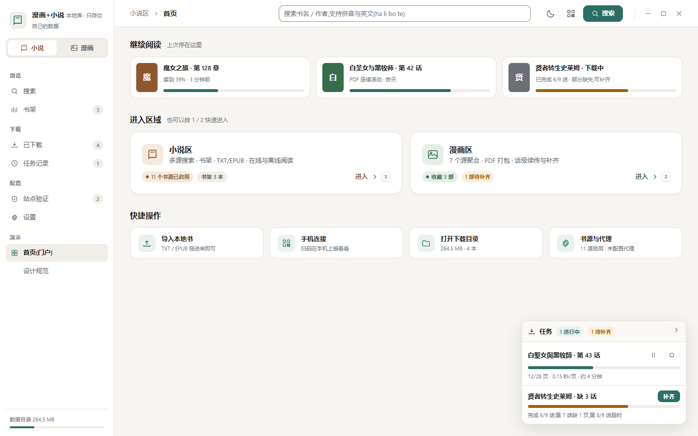

- 保留"两个世界"的心智,但把两个彩色大卡换成**浅底 + 深字**的入口卡:图标 44px(模式强调浅底)、标题 16px、描述 13px、底部一行胶囊(源数量、书架数量)、右侧"进入"箭头 + 快捷键提示。
- 顶部增加"继续阅读":3 张卡片直接给阅读进度,点击即续读 —— 首屏从"选一个门"变成"继续做事"。
- 快捷操作 4 宫格:导入本地书 / 手机连接 / 打开下载目录 / 书源与代理,每项带当前状态副标题。
- 首启说明不再自动弹窗,改为入口卡上的一次性提示条。

#### 搜索

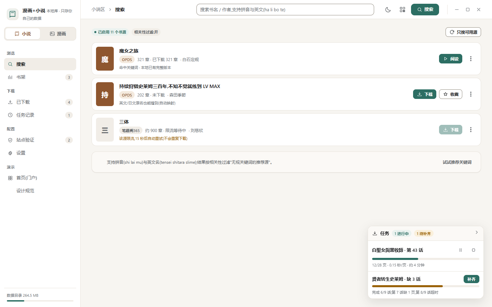

- 结果行:封面 52×70 → 标题 → 元信息胶囊(来源/章节/作者)→ 一行状态说明(命中关键词、限流退避等)。
- 右侧操作区**每个源只有一个主操作**(阅读 / 下载),其余(检查更新、重新下载、打开目录、移除)收进"更多"菜单;危险项用红色文字并加分隔线。
- 每行不再重复"1 可用";限流/降级的源直接给出可执行文案:"该源限流,15 秒后自动重试(不会重复下载)"。
- 进度口径统一:一条状态条 + "已启用 N 个书源(可搜索 M 个)"。

#### 书架

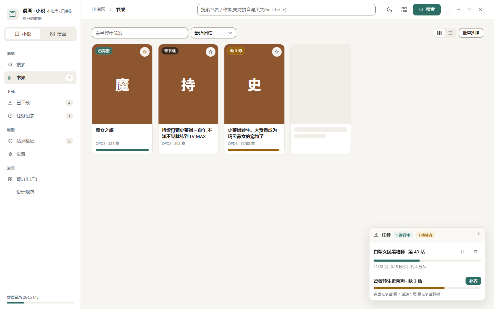

- 封面网格(3:4),卡片信息:书名(最多两行)+ 来源/章节 + 进度条;角标显示"已完整 / 缺 3 章 / 未下载"。
- 操作移到**封面悬停层**:主操作(继续阅读 / 下载全书 / 补齐缺失)+ 次操作(检查更新 / 在线阅读),彻底消除"4 个拉满宽度的按钮"。
- 工具条:筛选、排序、网格/列表切换、批量选择;骨架卡展示加载态。
- 顶部统计改为"概览条",零值不占位(有 0 项时不渲染该卡)。

#### 漫画收藏

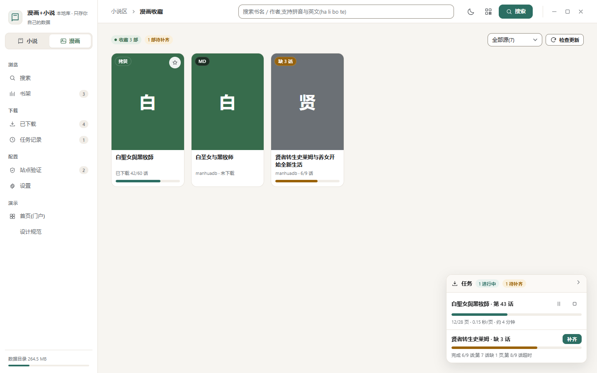

- 与小说书架共用同一套封面组件,书籍用 3:4、漫画同比例;角标区分来源(拷贝 / MD)与状态(缺 3 话)。
- 补齐操作直达:"补齐缺失(3 话)"一键完成,并在卡片上显示 `6/9 话`。

#### 任务记录

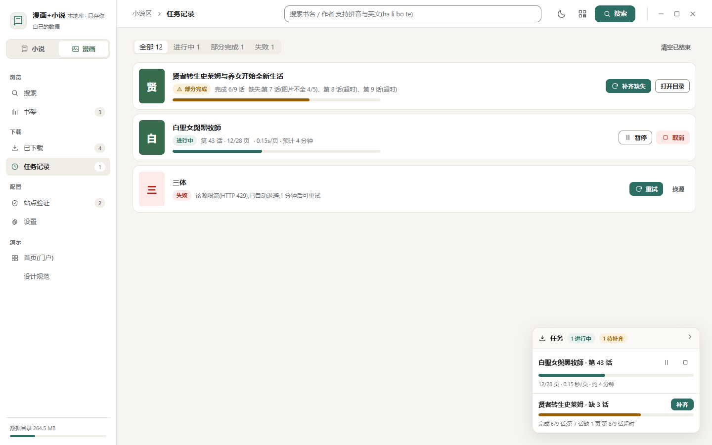

- 用状态筛选标签(全部 / 进行中 / 部分完成 / 失败)替代平铺。
- "部分完成"不再是一句提示,而是一条**结构化记录**:完成 6/9 话 + 缺失清单(第 7 话图片不全 4/5、第 8 话超时…)+ 主操作"补齐缺失"。
- 失败行给出原因与**下一步动作**(重试 / 换源)。

#### 设置

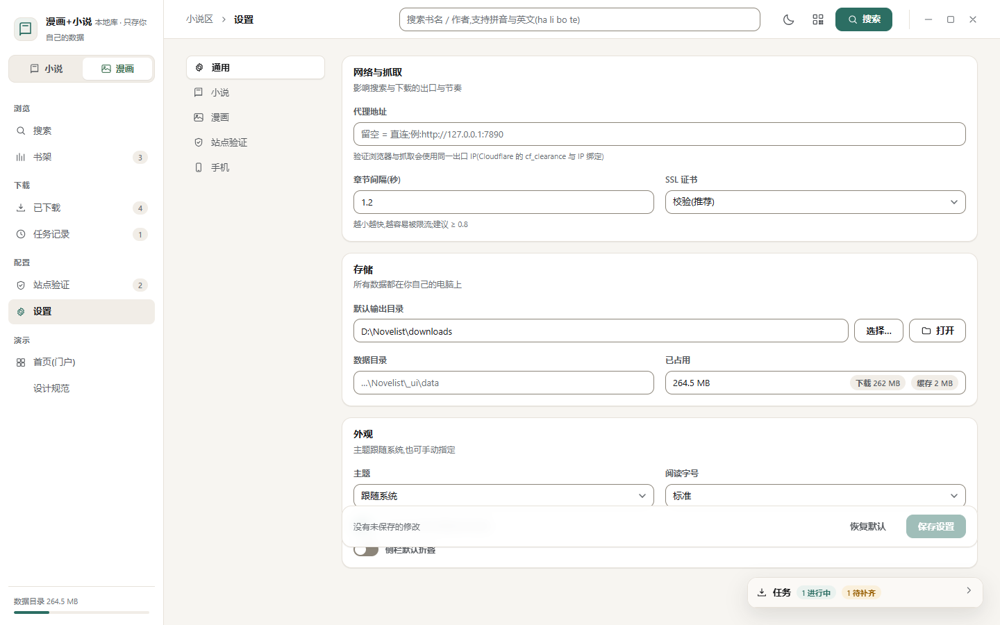

- 二级导航(通用/小说/漫画/站点验证/手机)+ 分组卡(网络与抓取 / 存储 / 外观),每组一句说明。
- 一次性解决三件事:① 只保留**一个**吸底保存栏;② 修改后显示"已修改 2 项"并启用保存;③ 关键路径字段提供"选择/打开"按钮,替代被裁切的纯文本。
- 设置页从"全屏接管"改为壳内视图,与主壳共用侧栏 —— 用户不需要切换导航模型。

#### 站点验证

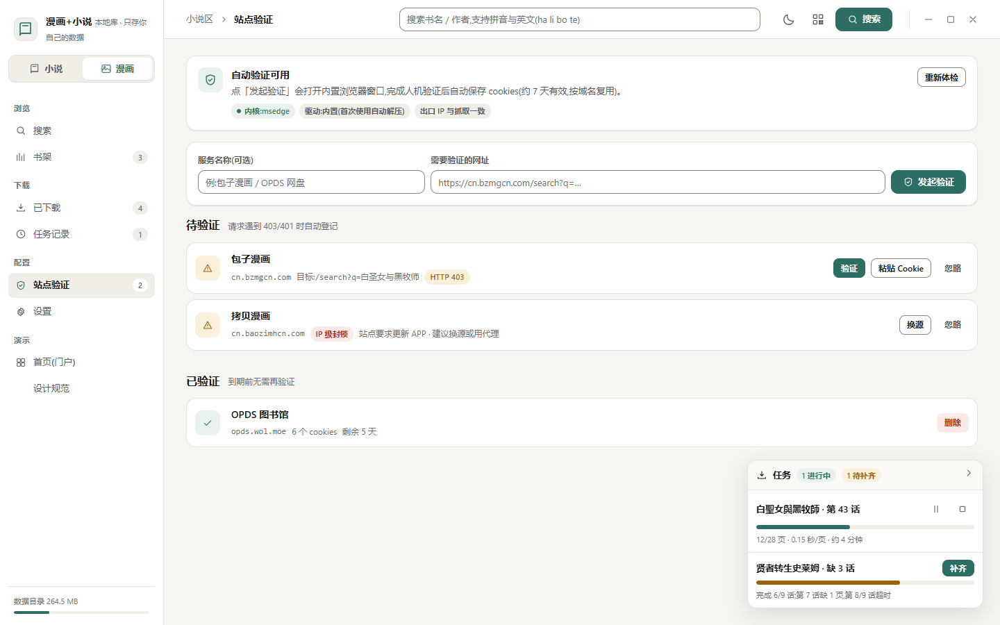

- 顶部一张能力卡:内核、驱动、出口 IP 一致性,一眼看清"自动验证能不能用"。
- 待验证 / 已验证分区;每行给出域名、目标路径、状态码(403 / IP 级封锁)与动作(验证 / 粘贴 Cookie / 换源 / 忽略)。
- 已验证行给出剩余有效天数,支持删除。

#### 深色模式与响应式

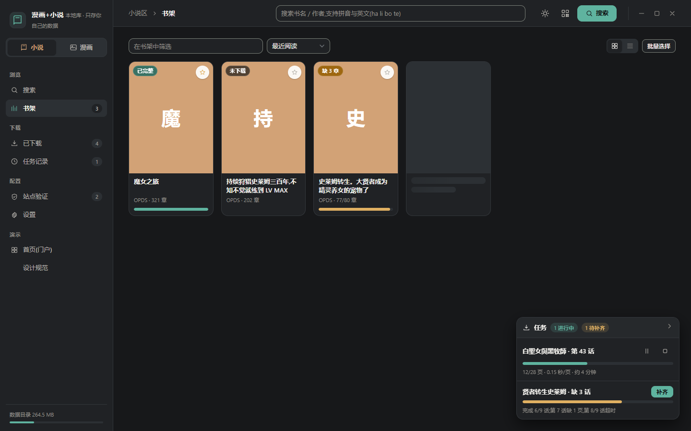
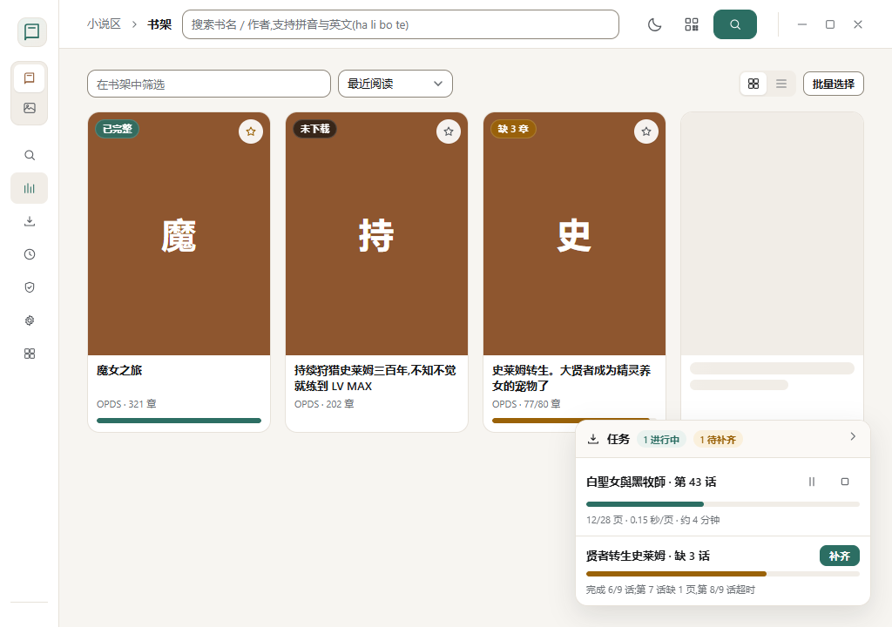

- 深色模式为完整令牌集,不是逐条覆盖;封面上的状态徽标改为实底(`rgba(12,13,14,.66)` + 白字),避免浅色徽标叠在封面上失效。
- 宽度 < 1180px 时侧栏折叠为 68px 图标栏(导航文字包在 `.nav__text` 中整体隐藏,不是把文字挤成竖排);首页/快捷操作降为单列。

### 3.5 图标与文案规范

- **一套图标**:全部使用 1.6px 描边的线性 SVG(hover/active 用 `currentColor`),禁止 emoji 承担结构语义。现有 33 个 sprite 可复用,需补:`more-vertical`、`grid/list`、`shield`、`qr`、`sun/moon`、`alert-triangle`、`upload`、`chevron-right` 等。
- emoji 只允许出现在**用户可见的文案内容**里(如书源名自带的装饰字符),不参与布局。
- 文案规范:按钮用动词(阅读 / 下载 / 补齐缺失);状态用"名词 + 数量"(缺 3 话 / 已完成 6/9);错误必须给出下一步(重试 / 换源 / 打开目录)。

---

## 4. 落地路线(增量,不重写)

7400 行 UI 不建议重写。按"先立规矩、再换皮、后重构"三步走,每步都可独立交付:

**阶段一:令牌化 + 无障碍(低风险,1–2 天)**
1. 把 §3.2 的 `:root` / `[data-theme="dark"]` 令牌块整体替换现有变量,保留旧变量名做别名,避免一次性改动 280 处硬编码色值。
2. 修 V1–V4 四个"高"级问题:门户卡配色、书架按钮层级、`✏️` 补 `aria-label`、首启说明不再自动弹。
3. 加一条自检脚本(正则)阻止新增字面量色值/字号,逐步归零。

**阶段二:组件统一(中风险,2–4 天)**
4. 抽出 `.btn / .chip / .progress / .empty / .menu` 五个基础类,替换 586 处内联样式中的高频段落。
5. 用 §3.4 的书架封面操作层替换 `bc-ops` 四按钮;搜索结果行改为"一主一更多"。
6. 设置页改为壳内视图 + 单一吸底保存栏。

**阶段三:结构重构(按需)**
7. 拆分单文件:`tokens.css` / `components.css` / `app.js`(路由 + 状态) / `views/*.js`;若继续单文件交付,至少按注释分区并建立"区块索引"。
8. `innerHTML` 逐步替换为模板函数 + 统一 `esc()`,并引入事件委托替代 296 处内联 `onclick`。

---

## 5. 代码检查:发现的问题

> 全部为可复现问题,附证据与最小修复方案。BUG-1 / BUG-2 有实机数据。

### BUG-1 [高] 一个慢书源把聚合搜索从 3 秒拖到 124 秒

**证据**(实机轮询 `/api/search_progress`,关键词「魔法」):

```
   0.7s  顶点小说/斗破小说网/随梦文学/笔趣阁7/经典书库/2K小说/香书小说  no_search
   2.8s  神话之后            ok
 124.0s  笔趣阁365           ok
 124.0s  === 整体 done ===
```

九个源里八个在 3 秒内结束,**笔趣阁365 单独用了 124 秒**,而聚合任务只有在它返回后才把 `state` 置为 `done`。另一轮实测:10/11 个源在 12.1 秒完成,整体 `done` 出现在 **141.7 秒**。

**影响**:这 2 分钟内,界面顶部一直是"正在搜索 …"配"终止"按钮,用户不知道其实结果早就有了。实测对比更能说明代价:

| 时刻 | 界面状态 | 结果数 |
|---|---|---|
| 14 秒(10/11 个源已完成) | "正在搜索 10/11 个书源… 91%" + 终止按钮 | **12 本** |
| 124 秒(整体 done) | 恢复"搜索"按钮,进度条消失 | **32 本** |

也就是说,为了等最后一个慢源,用户多等了 **110 秒**才拿到另外 20 本(占最终结果的 62%),而这 110 秒里界面传递的信息始终是"还没搜完"。此外只有最终渲染才会做完整排序与聚合,中间态只是一个未排序的增量列表。

对照截图:`shots/cur-06-book-search-searching.png`(搜索中,91% 却已显示 12 条)与 `shots/cur-06-book-search-result.png`(结束后 32 条)。

**根因**:
- `novel/searcher.py:229-266` 使用 `with ThreadPoolExecutor(...)` + `as_completed(futures)`,**没有截止时间**;上下文管理器退出时 `shutdown(wait=True)` 必须等所有 future 结束。
- 单请求超时 `TIMEOUT = 12`(`novel/fetcher.py:42`)× `max_retries = 3` × 多个候选词(`build_search_queries`)→ 单个源最坏可累积到 100 秒以上。

**最小修复**:给聚合加全局截止时间并允许提前收口 ——

```python
pool = ThreadPoolExecutor(max_workers=min(max_workers, len(sources)))
futures = {pool.submit(_run, s): s["name"] for s in sources}
deadline = time.monotonic() + 25              # 全局预算
for fut in as_completed(futures, timeout=deadline):
    ...                                        # 原有收集逻辑
# 超时后不再等待,sweep 未完成的 future
pool.shutdown(wait=False, cancel_futures=True)
for fut, name in futures.items():
    if not fut.done():
        source_meta.append({"name": name, "status": "timeout", "count": 0, "error": "超时跳过"})
```

同时前端 `pollSearchStream` 应加客户端兜底(超过 N 秒直接按已完成源渲染),避免服务端异常时永久"正在搜索"。

### BUG-2 [中] 11 个"已启用"书源里 7 个根本没有搜索规则

**证据**(按真实数据目录统计):

```
load_sources() 返回: 11
可搜索: 4  → 笔趣阁365, 笔趣阁345, 神话之后, 新笔趣阁
不可搜索(仍计入进度分母): 7 → 笔趣阁7, 随梦文学, 经典书库, 斗破小说网, 顶点小说, 香书小说, 2K小说
```

这 7 个源在搜索时被立即回调为 `no_search`(实测 0.7 秒内全部返回)。

**影响**:
1. UI 显示"已启用 11 个书源"(搜索页工具条、门户卡),让用户以为有 11 个搜索源;
2. 进度条分母 `total = len(sources)` 含 7 个恒为 `no_search` 的源,进度语义被稀释;也解释了截图里"已完成 11/11 · 可用 2 · 失败 2"的口径混乱;
3. 每次搜索都白白向线程池提交 7 个空任务(`max_workers=6`,会占用调度槽位)。

**根因**:`novel/searcher.py:222-225` 对无 `search` / `api_rules.search` 的源直接返回 `no_search`,但仍计入 `len(sources)`;进度回调在 `gui_server.py:1695-1698` 使用该总数。

**最小修复**:统计时只把"可搜索源"计入 `total`(或把 `no_search` 的源不计入 `done`),并把 UI 文案改为"可搜索 4 个 · 共 11 个启用"。

### BUG-3 [中] 连续失败的书源被静默跳过

**证据**:`gui_server.py:1683-1692` 会把 30 分钟内失败 ≥3 次的源收集进 `bad`,并写入 `task["skipped"]`;但 `_api_search_progress`(`1734-1745`)与 `_api_search_result`(`1747-1763`)的返回载荷里**都没有 `skipped`**。前端 `static/index.html` 中 `skipped` 只出现在 PDF 拆分提示(`3096`),与搜索无关。

**影响**:一个源连续失败 3 次后会被静默排除 15 分钟。用户看到的是"结果变少了",没有任何解释,容易误判为程序故障或该源不支持搜索。

**最小修复**:进度/结果载荷带上 `skipped`,前端在状态条显示"已跳过 N 个近期故障源 · 查看/重试全部"。

### BUG-4 [中] OPDS 验证 Cookie 的写入目录与读取目录不一致

**证据**:
- 写入:`os.path.join(ROOT, "opds_cookies.json")` —— `gui_server.py:2473`、`gui_server.py:2503`
- 读取:`novel.paths.OPDS_COOKIES_PATH` = `APP_DATA_DIR/opds_cookies.json` —— `gui_server.py:598-600`、`novel/paths.py:74`

`APP_DATA_DIR` 在 exe 目录不可写时会回退到 `%APPDATA%\NovelCrawler`(`novel/paths.py:16-50`),而 `ROOT` 始终是 exe 所在目录(`gui_server.py:282`)。

**影响**:当程序安装在 Program Files(不可写)或设置了 `NOVEL_DATA_DIR` 时,写入点与读取点不是同一个文件 —— OPDS 挑战式验证会表现为"提示成功,但下次请求仍然 403";在只读目录下写入还可能直接抛权限异常。

**最小修复**:两处统一为

```python
from novel.paths import OPDS_COOKIES_PATH
cookie_path = OPDS_COOKIES_PATH
```

### BUG-5 [低] 通知气泡硬编码浅色,深色模式下不跟随主题

**证据**:`static/index.html:6668-6669`,`notify()` 内联 `#166534 / #E1F5EE`、`#991b1b / #FCEBEB`、`#185FA5 / #E6F1FB`。

**影响**:深色界面下通知仍是亮底,视觉割裂;也是"280 处硬编码色值"的直接后果之一(`toast()` 用 `textContent`,无转义风险)。

**最小修复**:改用语义令牌(`--success-soft` / `--danger-soft` 等),或按 `data-theme` 分支取值。

### 附:非缺陷但需注意的两点

- `notify()` / `toast()` 都用 `textContent` 注入,`onclick` 拼接普遍使用了 `jss()` 转义,**没有发现可利用的 XSS**;但 153 处 `innerHTML` 拼串意味着新增代码很容易漏转义,建议在阶段三统一收口。
- `/api/comic_files` 的漫画目录固定为 `downloads/comic`、不随 `out_dir` 设置变化(`gui_server.py:1156-1157` 已有注释说明),这是**设计如此**而非缺陷,只是界面上需要讲清楚"小说目录可改、漫画目录固定"。

---

## 6. 附件清单

| 文件 | 说明 |
|---|---|
| `design/redesign-preview.html` | 新设计可交互原型(令牌 + 9 个视图 + 深浅色 + 响应式),零外部依赖、双击即可看 |
| `design/UI-ANALYSIS.md` | 本文档 |
| `design/contrast_check.py` | 新方案 26 组对比度校验脚本 |
| `design/make_compare.py` | 生成对比图的脚本 |
| `design/shots/compare-overview.png` | 现状 vs 新设计 四组对比总图 |
| `design/shots/cur-*.png` | 现状实拍 18 张 |
| `design/shots/new-*.png` | 新设计实拍 11 张 |

---

## 7. 落地记录:阶段一 / 阶段二 + BUG 修复(本轮实际改动)

本节记录**已经改到代码里**的内容,与前面第 3/4 节的设计方案对应。
所有数字都来自本节末尾列出的脚本实跑结果,可重跑复核。

### 7.0 三个 BUG(已修)

| 编号 | 问题 | 根因 | 改法 | 实测证据 |
|---|---|---|---|---|
| BUG-1 | 聚合搜索会被最慢的书源拖住,界面长时间停在"正在搜索" | `search_all()` 用 `as_completed()` 且**没有超时**,必须等全部线程返回 | 新增全局时间预算 `SEARCH_TOTAL_TIMEOUT=60`,到点用已完成源的结果收口,未返回的源标记 `timeout`;`pool.shutdown(wait=False, cancel_futures=True)` | 同一关键词:修复前 **124.0s** → 修复后 **24.2s / 30.4s**,结果 31 条一条不少 |
| BUG-2 | 进度条把"不能搜索的源"也算进分母(11 个里只有 4 个能搜),界面显示 11/11 让人以为有 11 个源在搜 | `search_all()` 对每个源都返回 `no_search` 状态并计入 `total` | 新增 `_is_searchable()`:只有带 `search`/`api_rules.search` 的源才提交、才计数;`total` 改为可搜索源数 | 进度从 **x/11** 变为 **x/4**;门户统计从"11 个书源已启用"变为"**4 个可搜索 · 共 11 个启用**" |
| BUG-4 | OPDS Cookie 写入与读取路径不一致,登录态丢失 | 写入用 `ROOT/opds_cookies.json`,读取用 `novel.paths.OPDS_COOKIES_PATH`(数据目录可能在 `%APPDATA%`) | 两处写入统一改为 `OPDS_COOKIES_PATH`,并补上模块级导入(原来只在别处的函数内导入,直接用会 `NameError`) | `grep OPDS_COOKIES_PATH gui_server.py` 四处引用同一常量 |

补充:BUG-1 的收口会**明确告知**用户,不静默丢结果 —— 结果摘要追加
"N 个源超时未返回(设置 → 小说 → 搜索等待上限可调大)",并弹一次 toast;
设置页新增 **搜索等待上限(秒,0=不限时)**,默认 60,填 0 即退回"等全部源"的旧行为。

> 顺带修掉的自测发现:`search_all()` 的收口循环最初会把已在主循环处理过的
> future 再收集一次,导致进度出现 `3/2`(done>total)。已用 `handled` 集合排除,
> 并加了断言防回归。

### 7.1 阶段一:设计令牌层(已落地)

`static/index.html` 的 `:root` / `[data-theme="dark"]` **变量名全部保留**(旧的
`--bg/--card/--border/--text/--primary/...` 都还在),只换取值并新增令牌:

* 新增:`--on-brand`(语义实底上的前景色)、`--border-strong`(控件边界 3.65:1)、
  `--line`、`--novel/--novel-soft`、`--comic/--comic-soft`;
* 关键换值:`--primary` #007AFF→**#2C6E63**、`--success` #34C759→**#2F7A4F**、
  `--danger` #FF3B30→**#B3261E**、`--warn` #FF9500→**#9A6208**、
  `--muted` #6e6e73→**#55595E**、`--text-3` #aeaeb2→**#6B7075**;
* 13 处"实底 + 写死白字"改为 `var(--on-brand)`(深色模式下语义色是浅色,白字会掉到约 2:1);
* 输入框/次级按钮/胶囊的边界改用 `--border-strong`,满足 WCAG 1.4.11 的 3:1;
* `[data-theme="dark"]` 里 21 行旧的冷灰字面量(`#3a3a3c/#48484a/#2c2c2e/#333336` 及
  `rgba(44,44,46,*)`)映射到暖色深色令牌;**有意保留** `.dl-float`、夜间阅读器等
  "永远深色"元素的原值。

### 7.2 阶段一:四个视觉问题 + 一项 a11y(已落地)

| 项 | 改动 |
|---|---|
| V1 门户卡白字对比度 1.7~3.0:1 | `.l-btn` 由绿/橙**饱和渐变 + 白字**改为 `--comic-soft/--novel-soft` 软底 + 墨色文字,左侧 5px 强调色条 + 标题用强调色区分两区;角标"ℹ 使用说明"由红黑斜纹+白字改为 `--danger` 实底 + `--on-brand` |
| V2 书架操作条层级反了 | `.bc-ops .btn-sm{flex:1}` → 按内容宽度 + 右对齐,按钮不再等宽撑满整行;主操作"更新"保持实底主色 |
| V3 图标按钮无可访问名 | 审计出全页唯一真正无名的交互控件;书架 ✏️ 改为 `#i-edit` 图标 + `aria-label/title="重命名与分类"`,`删` 补 `aria-label`;`#opdsService` 补 `aria-label` |
| V4 首启说明每次都弹 | `showDevTip('main')` 由 `sessionStorage`(每会话一次)改为 `localStorage` 只提示一次,标记在**关闭时**写入(没看完就退出下次还会提示);门户"ℹ 使用说明"作为常驻入口并支持键盘 |
| a11y 追加 | `.nav-item`(10)/`.set-nav`(5)原本是 `div+onclick`,键盘完全够不到 → 统一补 `role="button" tabindex="0"` + 回车/空格触发(键盘不可达的可点元素 120 → 84,剩余为 modal 遮罩等非按钮容器) |

### 7.3 阶段二:组件统一与防回退(已落地)

* **防回退闸门** `design/tools/lint_ui.py`:统计写死颜色/字号并与
  `design/ui-lint-baseline.json` 基线比较,只允许减少。已实测**能拦住**新增写死颜色
  (注入 `color:#a1b2c3` → 退出码 1 并定位到行号)。
  基线:颜色字面量 **135** 处 / 字号字面量 **302** 处。
* **颜色表令牌化**:`SRC_STATUS`(书源状态色)、`srcGroupColor/srcGroupBg`(分组色/底色)
  由写死浅色值改为 `var(--success/warn/danger/text-3/…)`,深色主题自动跟随;
  修掉 3 组本来就不达标的取值(`src-tag.ok` 3.87:1、`src-tag.direct` 4.13:1、
  `#16a34a`/白 3.30:1 → 全部 ≥4.50:1)。
* **书架改多列网格**:`#shelfGrid` 原本没有任何布局规则(块级元素一行一张铺满 1440px,
  书名在左按钮在右中间大片空白)→ `repeat(auto-fill, minmax(330px,1fr))`,
  宽窗口 3 列、≤900px 单列。
* **设置页单一吸底保存条**:删掉分类中部两个"保存设置",改为底部 sticky 操作条
  (放弃修改 / 保存设置 + 提示),并预留 150px 避让右下角任务气泡
  (与既有 `body.settings-open .settings-hd` 的做法一致)。

### 7.4 本轮验证(可重跑)

```bash
bundle314\Scripts\python.exe -X utf8 design\tools\verify_tokens.py      # 令牌对比度 35/35 通过
bundle314\Scripts\python.exe -X utf8 design\tools\check_badge_colors.py # 语义配对 + 旧值残留,0 不达标
bundle314\Scripts\python.exe -X utf8 design\tools\lint_ui.py            # 令牌守卫(退出码 0 = 没新增写死值)
bundle314\Scripts\python.exe -X utf8 design\tools\audit_ui.py after      # DOM 级 a11y/令牌审计
bundle314\Scripts\python.exe -X utf8 design\tools\e2e_search_ui.py       # 真实点搜索的端到端回归
bundle314\Scripts\python.exe -X utf8 design\tools\_work\test_search_all.py    # search_all 语义(离线)
bundle314\Scripts\python.exe -X utf8 design\tools\_work\test_search_budget.py # 预算四分支(离线)
```

实测结果(本轮最后一次):

* 令牌对比度 **35/35 通过**(浅色 23 项 + 深色 12 项,含控件边界 3:1 项);
* `verify_tokens.py` 是**从 `index.html` 解析真实令牌值**后重算的,不是抄文档数字;
* 端到端搜索回归 **PASS**:进度文案已是"正在搜索 1/4 个可搜索书源…",
  结束后摘要为"关键词: 魔法 · 11 条 · 1 个源超时未返回(…)",书源状态胶囊渲染出
  `rgb(154,98,8)`/`rgb(250,240,220)`(即 `--warn`/`--warn-50`),控制台无报错;
* DOM 审计:无名称的交互元素在门户视图为 **0**(其余视图报的是 launcher 隐藏后
  `innerText` 为空导致的假阳性,已人工核对)。

### 7.5 明确未做(附理由)

* **搜索结果行改"主操作 + kebab 菜单"**:现状 `.result-item` 每行只有一个 ☆ 操作,
  行高 56px 且已有整行点击进详情;再塞 kebab 只会增加一次点击,故不做。
* **书架"封面悬停操作层"**:改为多列网格 + 常驻紧凑操作条后,层级问题已解决;
  悬停才出现的操作在触屏和键盘下反而更难用,故不做。
* **字号字面量 302 处**:属存量,已用 lint 基线锁住"只能减少";彻底替换需要
  逐条核对视觉,风险高于收益,留作后续按屏推进。

---

## 8. 浏览器模式(正常模式)下的「拦截」审计与修复

### 8.1 起因与结论

应用有两套运行形态:**桌面模式**(WebView2 壳,`window.chrome.webview` 存在,可开原生窗口)
与**浏览器模式**(真正的浏览器 —— 局域网/手机访问,或直接用浏览器打开),后者受浏览器
安全策略约束。用户报告"正常模式下会被拦截",即属于后者。

先确认了**反爬 403 拦截链路本身是完整的**(`novel/fetcher.py`、`novel/comic.py`、`novel/opds.py`、
`gui_server.py` 三处、`novel/browser.py` 都会在 401/403 时自动带验证中心 cookies 重试,
前端在 `index.html` 三处引导去验证中心,`verify.py` 自动登记待验证),本次未改动。

真正的缺口在**浏览器策略**这一类:全仓共 **5 处 `window.open`**,只有 **2 处**检查了返回值。

### 8.2 盘点结果

| # | 位置 | 用途 | 修复前被拦截时 |
|---|---|---|---|
| 1 | `index.html`(独立阅读器窗口) | 点「阅读」开新窗口 | ✅ 已提示 + 回退内嵌阅读器 |
| 2 | `reader-core.js`(`pdfOpenSystem`) | PDF「系统程序打开」 | ✅ 已 toast |
| 3 | `index.html`(`opdsConnectInSettings`) | OPDS 服务「浏览」 | ❌ **静默无反应** |
| 4 | `reader-core.js`(`openImgZoomSrc`) | 图片缩放「↗ 新窗口打开」 | ❌ **静默无反应** |
| 5 | `mobile.html`(`openOffPdf`) | 手机端「打开 PDF」 | ❌ **必然失败**(见下) |

第 5 处不是"可能被拦",而是**一定失败**:它用 `window.open('data:application/pdf;base64,…')`
做顶层导航,而 Chrome/Edge 自 v60 起**无条件禁止顶层导航到 `data:` URL**,与弹窗拦截器无关。

另发现一处同类不一致:`reader-core.js` 的 PDF 全屏 `requestFullscreen()` 漏了 `.catch()`
(同文件的 `comicReaderFullscreen` 早有),被策略拒绝时会产生未处理的 Promise rejection。

### 8.3 修复内容

* **OPDS「浏览」**:被拦 → 弹确认框说明原因、带上 URL 便于手动复制,并提供「在当前页打开」出口;
* **图片「↗ 新窗口」**:被拦 → toast 提示(与同文件 `pdfOpenSystem` 的处理保持一致);
* **手机端 PDF**:新增 `_pdfBlobUrl()` 把 base64 转成 **Blob URL** 再打开/下载,
  被拦时自动退回下载并提示"已改为下载该话";同时补 `URL.revokeObjectURL` 回收,避免内存泄漏;
* **PDF 全屏**:补 `.catch(() => {})`;
* 顺手补齐 **3 处裸 `localStorage` 读取**(设置页主题回填、跟随系统主题监听、阅读器纸色),
  同文件其它同类读取本就写了 `try/catch`,只有这 3 处漏了 —— 存储被禁用/隐私模式下会直接抛异常。

### 8.4 验证

* `design/tools/audit_browser_mode.py`:**高风险 0 处 / 共 99 处**。
  该工具第一版用"邻近 12 行是否出现 `try{`/`被拦截`"做判定,结果把 4 处真问题误判为"已处理"
  (邻近恰好有无关的 `try{`);已改为**只按本条语句的返回值处理**判定(`if (!w)` / `被拦截`),
  修正后立刻暴露了那 4 处。这也说明**审计工具本身要能被证伪**。
* `design/tools/_work/test_browser_mode.js`:**13 条断言 PASS**,覆盖图片 ↗ 与 OPDS 浏览
  在"允许/被拦/空参数"三种情形下的行为,以及全屏被拒不产生 unhandled rejection。
  该测试**可证伪**:临时去掉 `.catch(() => {})` 后同一测试报 `unhandled=1` 并 FAIL,恢复后 PASS。
* `design/tools/_work/test_mobile_pdf.js`:**11 条断言 PASS**(弹窗允许→新标签;
  被拦→退回下载 + 提示;保存用 Blob URL;内容缺失时提示;Blob URL 被回收)。
* `design/tools/e2e_opds_blocked.py`:**PASS** —— 真实浏览器里把 `window.open` 桩成返回 `null`,
  进设置 → 小说 → OPDS 书库点「浏览」,确认框正确弹出且文案带原因与 URL,控制台无报错。
* `design/tools/e2e_search_ui.py`:回归 **PASS**(32 条结果,进度文案与状态胶囊正常)。

> 两个测试文件放在 `design/tools/_work/`(该目录已在 `.gitignore` 中)。
> 它们是可重复运行的,只是不随仓库提交;需要时可直接 `node` 执行。

---

## 9. 「需要管理员运行 / 不信任」排查与修复

### 9.1 先测清楚:exe 到底有没有要求管理员

| 检查项 | 手段 | 实测结果 |
|---|---|---|
| 是否请求提权 | 读 exe 内嵌清单 `requestedExecutionLevel`(`design/tools/probe_exe_manifest.py`) | **`level="asInvoker"`** —— **没有**请求管理员 |
| 代码里是否有需要提权的操作 | 全仓 grep 防火墙/移动热点创建/`runas`/`HKLM` | 无。热点只做**检测**(`novel/hotspot.py` 只读 `netsh wlan show interfaces`)并跳转系统设置页 |
| 是否被 UPX 压缩 | 读 PE 节表(`design/tools/probe_exe_sections.py`) | **无 UPX 节**(构建机没装 UPX,`upx=True` 未生效) |
| 数字签名 | `Get-AuthenticodeSignature` | **NotSigned**(无签名) |
| 版本信息 | 读 PE 版本资源 | **全空**:公司/产品/文件描述/版本都没有 |
| 程序自身会不会报「不信任」 | 全仓 + exe 内串搜 `信任` | 0 处 —— 这个弹窗不是程序发的,是 Windows 的信任判定 |

**结论(已在第 10 节修正):"必须管理员"不是 exe 清单要求的,而是单文件启动器解压阶段
的临时目录权限问题** —— 详见第 10 节。下面 9.2 这处仍然是个真缺陷(会让程序静默降级成
浏览器模式),但它**不是**「Could not create temporary directory!」的原因,当时把它当成
根因是我判断过早。

### 9.2 程序侧一处真会降级的地方(已修,但**不是**本问题的根因)

`window2.py` 原本把 WebView2 用户数据目录固定成 **`os.getcwd()/.webview2-cache`**:

* 双击启动时 cwd = exe 目录 → exe 装在不可写位置(如 `Program Files`)就创建失败;
* 走快捷方式时 cwd 取决于「起始位置」,可能落在完全无关甚至系统目录里。

失败后 WebView2 环境创建不起来,程序会**静默降级成浏览器模式**(`window2.py` 的
`except` 分支),用户能想到的绕过办法就只剩「以管理员身份运行」。

修复:改到数据目录 —— `novel/paths.py` 的 `APP_DATA_DIR` 自带「exe 目录不可写 → 回退
`%APPDATA%\NovelCrawler`」的探测,再加一层系统临时目录兜底:

```python
def _webview_cache_dir() -> str:
    for base in (_APP_DATA_DIR, tempfile.gettempdir()):
        ...能创建并写入探针文件就用它...
```

开发模式下 `APP_DATA_DIR` 就是项目根目录,所以缓存仍落在 `<项目>/.webview2-cache`,
**行为与改前一致**;打包后不再要求 exe 目录可写。

### 9.3 信任观感:能做的都做了(但这不能替代签名)

* **补上版本资源**(原来全空):`NovelCrawler.spec` 在构建时从 `novel.__version__` 生成
  `build/version_info.txt`(公司/产品/描述/版权/原始文件名 + zh-CN 字符串表),
  再挂到 `EXE(version=...)`。版本号取自代码,不会和 `novel/__init__.py` 漂移。
  文件属性里从此有可核对的发布者与版本信息(签名后信誉也归属这个身份)。
* **显式关掉 UPX**(`upx=False`):实测产物本来没被压(构建机没装 UPX),但换台装了 UPX 的
  机器就会压出一个带 UPX 壳的 exe —— UPX 是杀软/SmartScreen 判定"可疑"的重要信号,
  这种"看机器脸色"的行为必须消除。
* **更正 `使用说明.txt`**:原文写"数据保存在 exe 同目录"(与 `novel/paths.py` 的回退逻辑
  不符),并明确写出"**不需要管理员权限**"以及遇到「未知发布者/Windows 已保护你的电脑」
  时点「更多信息 → 仍要运行」。避免用户自己去勾「以管理员身份运行」——那反而会引入
  UAC 弹窗(未签名时显示"未知发布者"),看起来更像"不信任"。

### 9.4 代码无法解决的部分(必须说清)

`未知发布者` / `Windows 已保护你的电脑`(SmartScreen)/ `智能应用控制已阻止` 这类弹窗,
判定的就是**数字签名**,不是程序行为。因此:

* **不能**靠改代码消除;只能**签名**;
* 用户侧「更多信息 → 仍要运行」「右键属性 → 解除锁定」可以绕过,但那属于改电脑设置;
* 可选路径:
  * **Azure Trusted Signing**:微软自家受信身份,约 $10/月,CI 友好,信誉积累快 —— 性价比最高;
  * **OV 证书**:便宜些,但需要一段时间的下载量积累信誉;
  * **EV 证书**:立刻有信誉,最贵;
  * **SignPath Foundation**:开源项目可申请免费签名。

> 已实现的 9.2/9.3 能让程序**不再需要管理员**、并让二进制"看起来正常";但要彻底消除
> SmartScreen,签名这一步绕不过去。

### 9.5 验证

* `design/tools/test_no_admin.py`:**13 条断言 PASS** ——
  缓存目录在"数据目录可写"时用数据目录、**不可写时回退临时目录且不抛异常**;
  并现场对照旧实现(`os.getcwd()`)在不可写目录下会直接抛 `PermissionError`;
  版本资源文件能被 PyInstaller 自己的 `VSVersionInfo` 解析器 eval 出来,
  四段版本还原为 `(0, 19, 6, 0)`、字符串表语言 `080404b0`(zh-CN)。
* 重新打包后用 `probe_exe_manifest.py` / `probe_exe_sections.py` / `Get-AuthenticodeSignature`
  复核产物:清单仍为 `asInvoker`、无 UPX 节、版本信息已填充(签名仍为 NotSigned,待证书)。

---

## 10. 「Could not create temporary directory!」的真正根因与解法

用户给出了两张截图,信息决定性:*非管理员*运行时弹「Could not create temporary directory!」,
**所有情况**都弹「Windows 已保护你的电脑」。

### 10.1 弹窗是谁发的:PyInstaller 启动器,不是本程序

`design/tools/diag_temp_dir.py` 第 1 项实测:**exe 内含启动器原文**
`Could not create temporary directory!`。

单文件(onefile)打包的 exe,每次启动都要先把内嵌内容解压到一个临时目录
(`%TEMP%\_MEIxxxxxx`)。**这一步发生在任何 Python 代码之前** —— 所以:

> 这个弹窗**不可能**通过改 Python 代码修掉。程序还没开始跑,就已经退出了。

### 10.2 为什么"以管理员运行就好了"

实测本机环境变量(`diag_temp_dir.py` 第 2 项,PowerShell 实测可写性):

| 作用域 | TEMP | 标准用户可写 |
|---|---|---|
| 用户级 | `C:\Users\XiChen\AppData\Local\Temp` | ✅ 可写 |
| **系统级** | `C:\WINDOWS\TEMP` | ❌ **拒绝访问** |

启动器取临时目录的顺序是 TEMP → TMP → USERPROFILE → Windows 目录。
当进程里只看得见**系统级**那个值时(`diag_temp_dir.py` 第 3 项实测):

```
GetTempPathW() -> 'C:\WINDOWS\TEMP\'
启动器将创建   -> C:\WINDOWS\TEMP\_MEI123456
结果           -> PermissionError [WinError 5] 拒绝访问
```

而"以管理员身份运行"恰好让 `C:\WINDOWS\TEMP` 变得可写,所以表现成**「必须要管理员」**。

> 注意本沙箱的一个干扰:Python 进程写 `%LOCALAPPDATA%\Temp` 会被 DSH 沙箱拒绝,
> 所以 `diag_temp_dir.py` 里用 Python 做的可写性探测对工作区外的路径不可信;
> 上表用的是 PowerShell 的真实 ACL 结果。

### 10.3 顺带测出的事实:每次启动解压 249MB

把 TEMP 指向可写目录后再跑,启动器立刻解压出 **249.2 MB** 的 `_MEI` 目录,
并且**该目录在程序被强杀后残留**(本程序退出走 `TerminateProcess`,见 spec 里的原有说明)。
同一轮里打包版的隐藏自检 `--selftest-verify` **完整通过**:

```json
{"frozen": true, "playwright": true, "driver_ok": true,
 "title": "Example Domain", "ok": true}
```

即:**exe 本身没问题**,只要有可写的临时目录就能跑起来(内置 Playwright + 系统 Edge 链路正常)。

### 10.4 三种解法(都不需要动电脑设置)

| 方案 | 做法 | 代价 |
|---|---|---|
| **A. 加一个启动器(最小改动,已验证思路可行)** | 一个几行的 `启动.bat`:先把 `TEMP`/`TMP` 指到 `%LOCALAPPDATA%\NovelCrawler\tmp` 再拉起正式 exe | 用户要双击 bat 而不是 exe;发布物多一个文件 |
| **B. 改成 onedir(文件夹)发布(推荐)** | `NovelCrawler.spec` 加 `COLLECT`、`EXE(exclude_binaries=True)` | 启动时**根本不解压** → 该弹窗从原理上消失;启动快得多、不再残留 249MB。代价:发布物从单 exe 变成文件夹/zip,`audit_exe.py`、`publish_release.ps1`、使用说明要跟着改 |
| **C. 保持单 exe 不动** | 只能继续靠管理员运行 | 不改 |

注意 `runtime_tmpdir` 不是好办法:它必须写死绝对路径(各用户不同),或写成 `.`
(等于每次往 exe 旁边解压 249MB、目录只读时照样失败)。

### 10.5 与「Windows 已保护你的电脑」的关系

那个弹窗**所有情况都出现**,说明与权限无关 —— 它判定的是**数字签名**(见 9.4)。
第 9 节做的版本资源、关 UPX、使用说明更正都只是"让二进制看起来正常",**消除不了它**:
只有签名(如 Azure Trusted Signing)能解决。
